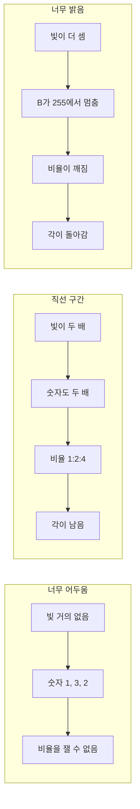
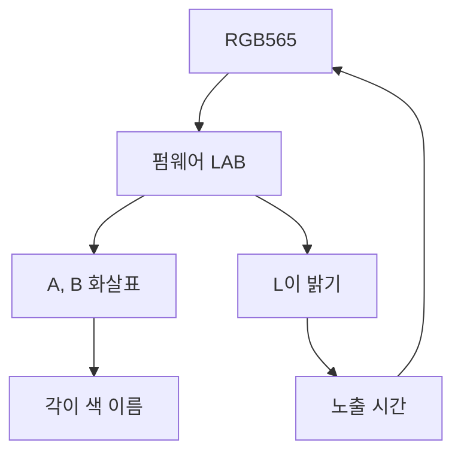

# 직선 구간

센서 숫자와 빛의 관계를 그린 것이다. 가운데만 비스듬한 직선이고, 그 구간에서만 페인트의 각이 남는다.

예시는 파란 페인트다. 비율은 R:G:B = 1:2:4이다. 채널은 0에서 255까지만 센다.

| 빛의 양 | 센서 숫자 | 비율 | 구간 |
| --- | --- | --- | --- |
| 거의 없음 | 1, 3, 2 | 잡음 | 직선 이전 |
| 1 | 10, 20, 40 | 1:2:4 | 직선 구간 |
| 2 | 20, 40, 80 | 1:2:4 | 직선 구간 |
| 8 | 80, 160, 255 | B가 멈춤 | 직선 끝 |

## L과 노출

L은 색 이름이 아니다. 면이 직선 구간에 있는지만 읽고, 노출이 다음 프레임의 RGB를 바꾼다.

이 표는 창을 고정한 뒤에만 돈다. 앞에서부터 보고, 먼저 걸린 줄만 실행한다. 그때 면이 없는 화면은 노출을 올리지 않는다. 잘림과 놓친 덩어리의 정의는 `description.md`와 같다.

| 순서 | 조건 | 노출 |
| --- | --- | --- |
| 1 | 직전 변경 후 다섯 프레임 | 유지 |
| 2 | 측정 틀 안 면의 L 상위 사분위가 95 이상 | 0.9배 |
| 3 | 측정 틀 안, 이름 없는 덩어리. 가로세로 20 이상, 반지름 10 이상, L 30 미만 | 1.2배 |
| 4 | 그 덩어리가 없고, 틀 안 가장 밝은 면의 L이 94 이상 | 0.9배 |
| 5 | 이번 프레임에 보라로 읽힌 면이 있고, 이번 등장에서 아직 한 번도 안 올렸으면 | 1.2배 |
| 6 | 그 밖 | 유지 |

시작은 7500 µs이다. 측정 틀 안에서 이름이 없으면 덩어리가 없을 때 노출을 바꾸지 않는다. 창은 1000–30000 µs다. 게인은 24 dB로 고정되어 있다.
